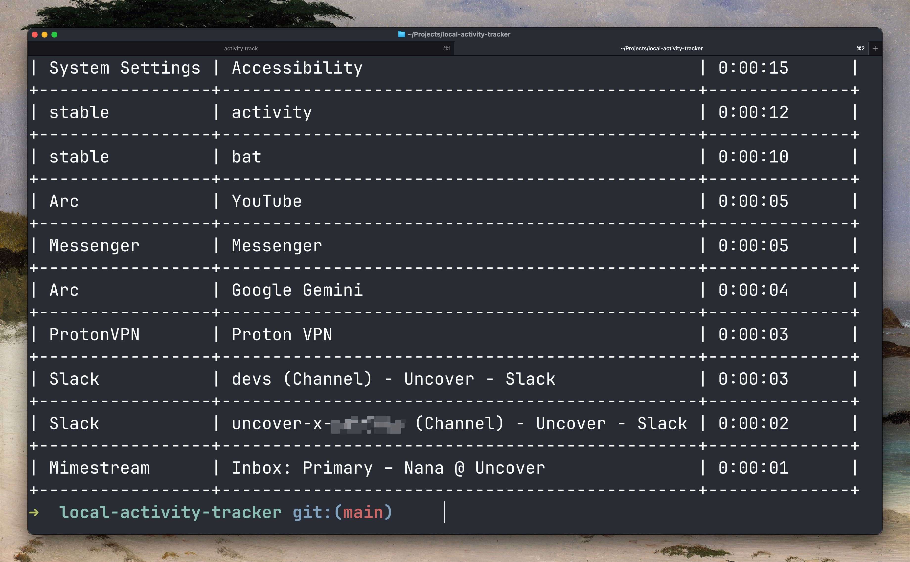

# Activity Tracker

A CLI application to track application usage and display summaries.



## Installation

```bash
pip install .
```

## Usage

### Start Tracking

```bash
activity track
```

### Daily Summary

```bash
activity daily
```

### Weekly Summary

```bash
activity weekly
```

### Monthly Summary

```bash
activity monthly
```

### Yearly Summary

```bash
activity yearly
```

### Mac App

```bash
.venv/bin/python -m src.main app install
```

This builds **Activity Tracker.app** in `~/Applications` and opens it: a normal Mac window with its own Dock icon, showing the timeline. While it is running, right-click the Dock icon and choose **Options → Keep in Dock**. To open it at login, add it under System Settings → General → Login Items.

Opening the app starts the web server if it isn't already running, and quitting leaves recording untouched — the tracker is a separate process, controlled by the button in the window. Ticket links open in your browser.

The app needs its own environment, which `app install` expects at `.venv`:

```bash
python3 -m venv .venv
.venv/bin/pip install Flask pyobjc-framework-WebKit py2app tabulate
```

The bundle runs the code in this folder rather than a copy, so your edits show up the next time you open the app. Run `app install` again after moving the project, `app uninstall` to remove it, and `python scripts/make_icon.py` (needs Pillow) to redraw the icon.

### Start Automatically at Login

```bash
activity autostart install    # also starts both right away
activity autostart status
activity autostart uninstall
```

This installs two launchd agents in `~/Library/LaunchAgents`: one runs the tracker and one serves the timeline at `http://activity.localhost:5001` (or `http://127.0.0.1:5001`). The web UI restarts if it crashes. The tracker restarts after a crash, but stays stopped if you click "Stop recording". Logs go to `~/Library/Logs/activity-tracker/`.

Because the tracker runs outside a terminal, macOS needs to allow Python in **System Settings → Privacy & Security → Accessibility** (and Automation, for browser URLs). If every entry shows as "Unknown", check `tracker.log` for the error.

### ClickUp Tickets

On the timeline, select one or more entries and click **Assign Ticket** to link them to a ClickUp task. The picker lists the tickets you used recently and the open tasks assigned to you. You can also paste a ClickUp task link, task ID or custom ID (e.g. `DEV-42`). Assigned tickets appear in the **Ticket** column, and the search box matches them too.

The first time, the picker asks for your personal API token (ClickUp → Settings → Apps). It is stored in the macOS Keychain under `activity-tracker.clickup`; set `CLICKUP_API_TOKEN` to override it.

### Web View

To view your activity in a web browser, run:

```bash
activity web
```

This will start a local web server. You can then open your web browser and navigate to `http://127.0.0.1:5001` to see your activity timeline.

The timeline view shows a 24-hour bar for the selected day, a table of entries (app, window title, browser URL, start/end, duration, idle %), and a per-app group view. You can:

- Start/stop recording from the page (the tracker runs in the background, independent of the web server)
- Hover the timeline for details, click a segment to jump to its entry, or drag across it to filter by time
- Search, sort columns, and select entries individually or per app from the group view
- Add (mark as added), merge, or delete selected entries

Browser URLs are captured for Safari and Chromium browsers (Chrome, Arc, Helium, Brave, Edge, Vivaldi); macOS will ask for Automation permission the first time.

The **Summary** tab (`/summary`) shows where time went by day, week, or month: tracked and active (non-idle) time, daily average, busiest day or hour, a stacked chart of time per hour/day, a per-app breakdown (click an app to see its top windows or sites), and top websites. Click a day in the chart to drill into it, or an hour to open it in the timeline. Time the tracker couldn't attribute (usually while the screen was locked) is excluded unless you tick "Include unidentified time".
